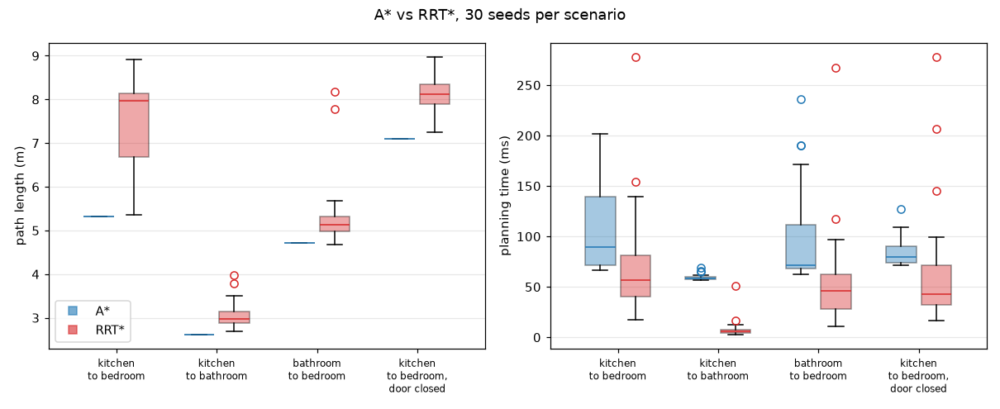

# navbench

Two robots start at the same spot in the same house and drive to the same goal. One plans its route with A* on a grid, the other with RRT*, which grows a random tree through free space. The animation shows both routes being driven at the same speed, so the difference in path length is easy to see.


In the second scene the short hallway to the bedroom closes one second after the start. Each robot whose route went through it plans again from where it is and goes round through the bathroom.


## Web viewer

`web/` is a static site. `index.html` is the start screen and `replay.html` is the viewer, where you can replay any run: pick the route and the RRT* seed, close the short hallway after one second, show the RRT* search tree, or draw all 30 routes on top of each other. It also has the results table and the write-up. Open `web/index.html` directly, or run `make serve` and go to http://127.0.0.1:8000.

The page does not plan anything itself. `make web` runs PyRoboSim for every route and seed and saves the paths, trees and times to `web/data.js`, and the page replays them.

To put it online, deploy the `web` folder as a static site, for example on Vercel with `web` as the root directory, or on GitHub Pages.

## Results

Each scenario was planned with seeds 0 to 29. Planning time includes building the occupancy grid for A*, which is about 70 ms of the total.

| scenario | planner | success | length (m) | best / worst (m) | median time (ms) |
|---|---|---|---|---|---|
| kitchen to bedroom | A* | 100% | 5.33 ± 0.00 | 5.33 / 5.33 | 75 |
| kitchen to bedroom | RRT* | 100% | 7.45 ± 1.05 | 5.36 / 8.91 | 45 |
| kitchen to bathroom | A* | 100% | 2.61 ± 0.00 | 2.61 / 2.61 | 63 |
| kitchen to bathroom | RRT* | 100% | 3.06 ± 0.30 | 2.68 / 3.98 | 6 |
| bathroom to bedroom | A* | 100% | 4.72 ± 0.00 | 4.72 / 4.72 | 71 |
| bathroom to bedroom | RRT* | 100% | 5.31 ± 0.76 | 4.68 / 8.18 | 44 |
| kitchen to bedroom, door closed | A* | 100% | 7.09 ± 0.00 | 7.09 / 7.09 | 79 |
| kitchen to bedroom, door closed | RRT* | 100% | 8.09 ± 0.41 | 7.26 / 8.98 | 47 |



A* gives the same path every time and was shorter on average in every scenario. RRT* took the short hallway from the kitchen to the bedroom in only 8 of 30 runs. The RRT* in PyRoboSim stops as soon as its two trees meet, so it does not use extra time to improve the path.

Times depend on the machine. Raw numbers are in `demos/bench.csv`.

## Run

Needs Python 3.12. `make video` also needs ffmpeg.

```
python3 -m venv .venv
.venv/bin/pip install -r requirements.txt
make smoke   # plan once with each planner, save demos/smoke.png
make gif     # render the race to demos/race.gif
make door    # render the closing door scene to demos/door.gif
make video   # both scenes as mp4
make bench   # 30 seeds per scenario, writes demos/bench.csv and demos/bench.png
make web     # plan every route and seed, write web/data.js for the viewer
make serve   # serve the viewer at http://127.0.0.1:8000
make test    # run the tests
make ui      # open the PyRoboSim web UI at http://127.0.0.1:8050
```

RRT* is random. The scripts take `--seed N`, so the same seed gives the same path. `bench.py --seeds N` changes the number of seeds.

## Code

`navbench/world.py` loads the world, sets up both planners, and plans with a fixed seed. `navbench/bench.py` runs the scenarios. `navbench/motion.py` moves a robot along a path at constant speed for the animations. `navbench/scenes.py` closes the hallway mid-run and replans. `navbench/export.py` collects everything for the web viewer, and `web/app.js` draws it. The scripts in the top folder draw the pictures.

## Credits

The world, robot model, and both planners come from [PyRoboSim](https://github.com/sea-bass/pyrobosim) by Sebastian Castro, released under the MIT license. This project only sets up the scenes, runs the planners, and draws the results.
