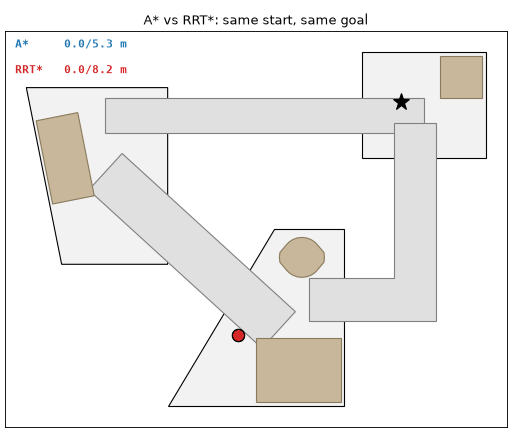

# navbench

Two robots start at the same spot in the same house and drive to the same goal. One plans its route with A* on a grid, the other with RRT*, which grows a random tree through free space. The animation shows both routes being driven at the same speed, so the difference in path length is easy to see.



## Run

Needs Python 3.12.

```
python3 -m venv .venv
.venv/bin/pip install -r requirements.txt
make smoke   # plan once with each planner, save demos/smoke.png
make gif     # render the race to demos/race.gif
make test    # run the tests
make ui      # open the PyRoboSim web UI at http://127.0.0.1:8050
```

RRT* is random. `demo.py` and `animate.py` take `--seed N` (default 0), so the same seed gives the same path.

## Credits

The world, robot model, and both planners come from [PyRoboSim](https://github.com/sea-bass/pyrobosim) by Sebastian Castro, released under the MIT license. This project only sets up the scene, runs the planners, and draws the results.
